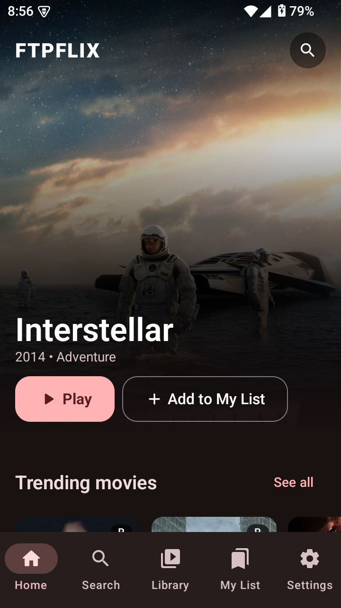
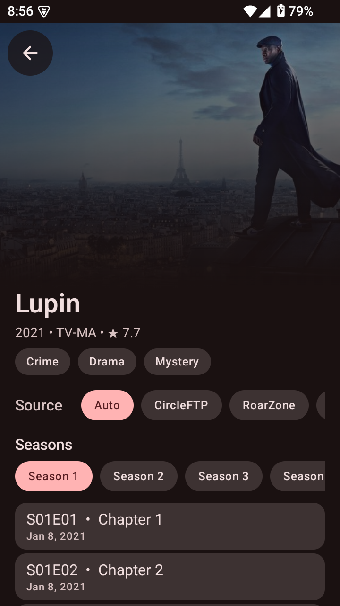
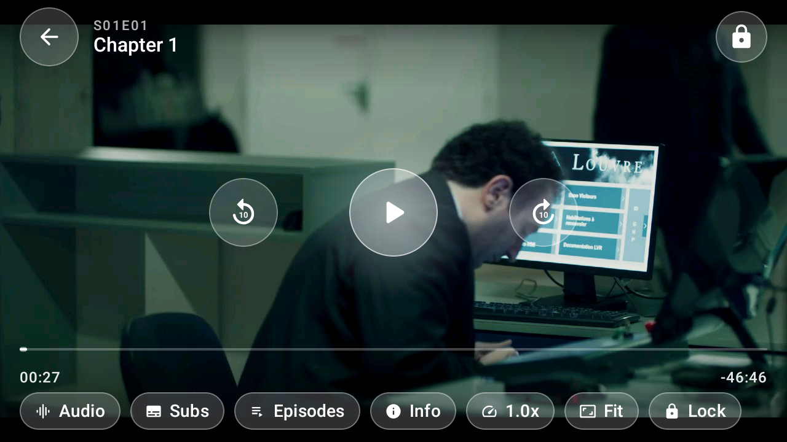
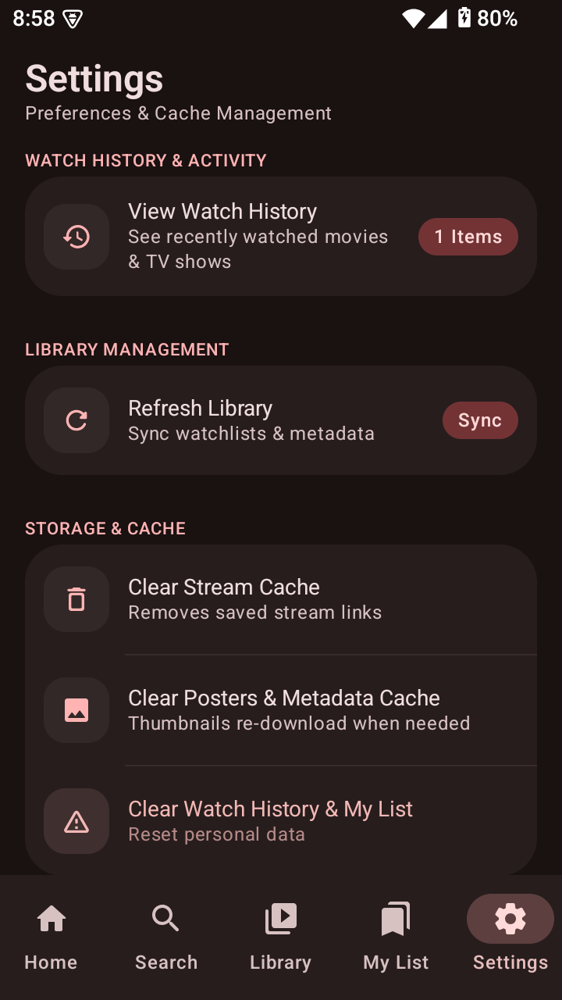

# FTPFlix

**A free, open-source Android app for watching movies and TV. No ads.**

FTPFlix pulls a handful of openly available third-party sources into one Material 3 app, so you can browse, search and start playing in a few taps.

> [!IMPORTANT]
> **Disclaimer:** FTPFlix doesn't host or store any media. It only indexes publicly available third-party sources, and the developer isn't responsible for what those sources serve.

---

## Download
| Variant | Best for | Download |
| --- | --- | --- |
| **arm64-v8a** | Most modern phones | [](https://github.com/Sadik084/FTPFlix/releases/latest/download/FTPFlix-arm64-v8a.apk) |
| armeabi-v7a | Older 32-bit devices | [](https://github.com/Sadik084/FTPFlix/releases/latest/download/FTPFlix-armeabi-v7a.apk) |
| x86_64 | Emulators and desktop | [](https://github.com/Sadik084/FTPFlix/releases/latest/download/FTPFlix-x86_64.apk) |
| Universal | Any device (biggest file) | [](https://github.com/Sadik084/FTPFlix/releases/latest/download/FTPFlix-universal.apk) |

> [!TIP]
> Not sure which one you need? Pick **universal**. The universal APK runs everywhere, but it's a larger download.
> After installing, the app can update itself from **Settings → App Update**, which checks GitHub Releases.

---

## Features

- **Browse and search:** a home feed with hero banners and poster rows, plus global search that remembers your history.
- **TMDB metadata:** posters, backdrops, ratings, genres, seasons and episode lists.
- **Multi-source playback:** streams are looked up across several public sources, and you choose the quality.
- **Wider audio support:** AC-3, E-AC-3, DTS and TrueHD play through a bundled FFmpeg decoder, which fixes MKV files that used to play with no sound.
- **Continue Watching:** jump back into a movie or episode right where you stopped, with your progress saved on your device.
- **Your library:** My List and watch history, all stored on your device.
- **Source control:** turn sources on or off and set the primary and fallback order in Settings.
- **In-app updates:** the app checks GitHub Releases and installs the APK that matches your device's ABI.
- **No ads, no tracking, no account needed.**

---

## Sources

### BDIX sources (may not work for everyone)
These are limited to Bangladesh, so they'll most likely only load on a Bangladeshi connection.

| Source | URL |
| --- | --- |
| CircleFTP | http://new.circleftp.net:5000/api |
| RoarZone | https://play.roarzone.net |

### Public sources (Stremio addons)

| Addon | URL |
| --- | --- |
| HdHub | https://stremio-addons.net/addons/hdhub |
| Hyper | https://hyper.stravo.site/local |

---

## How it works

1. **Catalog and search** come from the TMDB API. It provides metadata only, never streams.
2. When you hit play, FTPFlix asks your enabled sources, in priority order, for streams that match the movie or episode you picked.
3. You choose from the list of streams that come back. Playback uses Media3 ExoPlayer with hardware decoding, plus the bundled software audio decoder when needed.
4. Only links and metadata are cached locally. FTPFlix never hosts, uploads or stores media.

---

## Screenshots

| Home | Details | Player | Settings |
| :---: | :---: | :---: | :---: |
|  |  |  |  |

---

## Build from source

**You'll need**
- JDK 17 or newer
- The latest stable Android Studio
- A free [TMDB API key](https://www.themoviedb.org/settings/api)

**Steps**
```bash
git clone https://github.com/Sadik084/FTPFlix.git
cd FTPFlix
cp local.properties.example local.properties   # then set your TMDB_API_KEY
./gradlew assembleDebug                        # debug build
./gradlew prepareOtaApks                       # release APKs (ABI-split + universal) with publish-ready names
```

You can also open the project in Android Studio and press **Run**.

---

## Configuration

Everything is set in `local.properties` (copy it from `local.properties.example`):

| Key | What it does | Default |
| --- | --- | --- |
| `TMDB_API_KEY` | Required. Used for catalog metadata and search | none |
| `HDHUB_ADDON_URL` | Base URL of the HdHub Stremio addon (leave blank to disable it) | blank |
| `HYPER_ADDON_URL` | Base URL of the Hyper addon | `https://hyper.stravo.site/local` |
| `CIRCLEFTP_API_BASE` | CircleFTP BDIX API | `http://new.circleftp.net:5000/api` |
| `ROARZONE_BASE_URL` | RoarZone Emby server | `https://play.roarzone.net` |
| `GITHUB_OWNER` / `GITHUB_REPO` | Where in-app updates are fetched from | `Sadik084` / `FTPFlix` |
| `GITHUB_RELEASE_API` | GitHub API base URL | `https://api.github.com` |

Release signing is configured in `keystore.properties` (see `keystore.properties.example`).

---

## Tech stack

Kotlin · Jetpack Compose (Material 3) · Hilt · Retrofit / OkHttp · kotlinx.serialization · Media3 ExoPlayer (+ Jellyfin FFmpeg decoder) · Room · DataStore · Coil · WorkManager

---

## Credits

FTPFlix wouldn't exist without these providers:

-  **CircleFTP** for the BDIX search and stream API.
-  **RoarZone** for the Emby-based stream API.
- **Stremio addons:** [HdHub](https://stremio-addons.net/addons/hdhub) and [Hyper](https://hyper.stravo.site/), for the public stream sources.
- [](https://www.themoviedb.org)